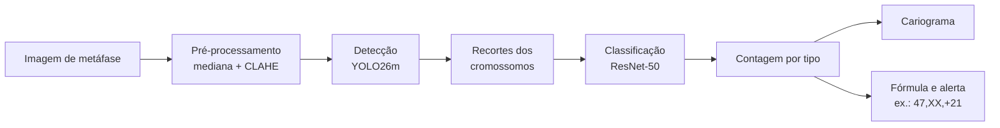
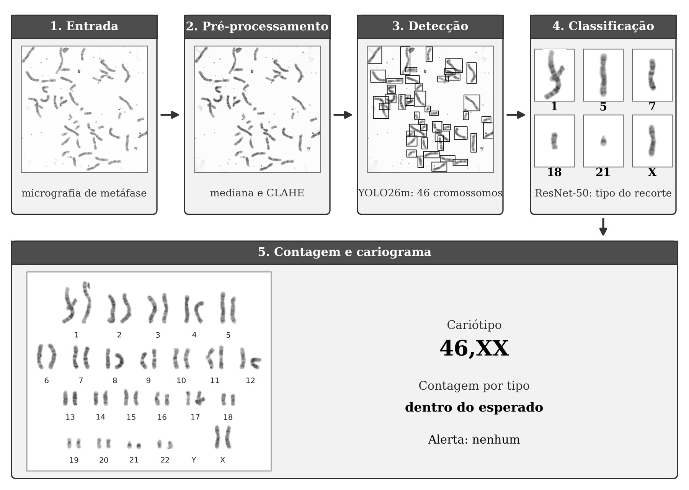
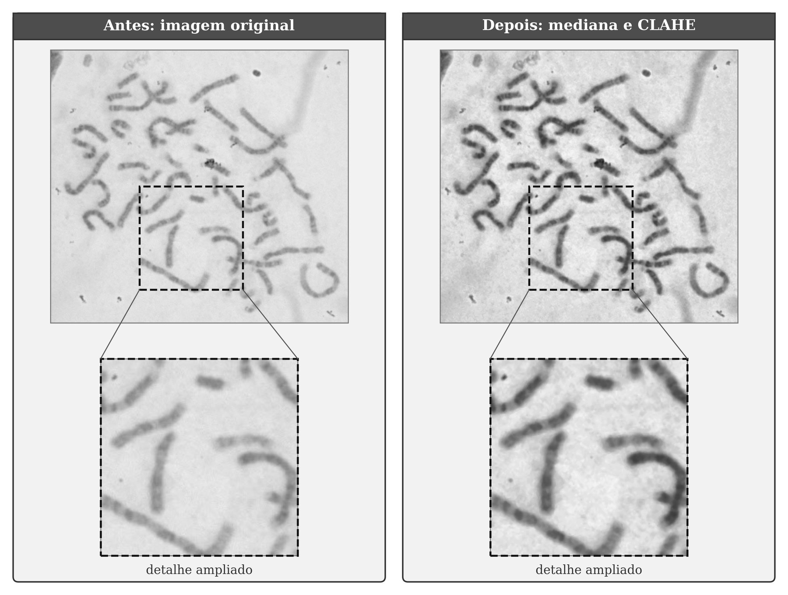
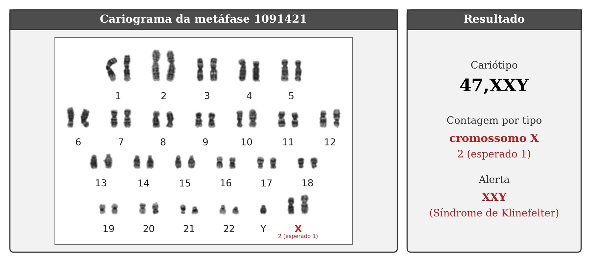

# CytoML – Análise Automatizada de Cariótipos

[](https://github.com/irlvinicius/CytoML/actions/workflows/ci.yml)
[](https://www.python.org/)
[](https://docs.astral.sh/uv/)
[](https://pytorch.org/)
[](https://docs.ultralytics.com/)
[](https://onnx.ai/)
[](https://huggingface.co/irlvinicius/KaryoVisio)

CytoML é uma pipeline de visão computacional para a análise automatizada de cariótipos humanos: a partir de uma imagem de metáfase, ela localiza cada cromossomo, identifica qual dos 24 tipos ele é (1 a 22, X e Y), monta o cariograma no formato do exame e sinaliza possíveis aneuploidias numéricas, como a trissomia do 21 (`47,XX,+21`).

## Visão Geral

Este repositório reúne o código, os notebooks e os resultados do Trabalho de Conclusão de Curso *Uso de Visão Computacional para análise automatizada de Cariótipos e identificação de aneuploidias* (UNIPÊ, 2026). A pipeline combina duas redes neurais convolucionais: o **YOLO26m**, que detecta os cromossomos na metáfase, e a **ResNet-50**, que classifica cada recorte. Cada etapa é avaliada com métricas próprias, e o conjunto, da imagem ao cariograma, com foco na sinalização de aneuploidias.

---

## O Problema

A cariotipagem é o exame de referência para detectar alterações cromossômicas numéricas e estruturais, como as síndromes de Down (trissomia do 21), Turner (45,X) e Klinefelter (47,XXY). Apesar disso, a análise ainda é majoritariamente manual:

| Dificuldade | Consequência |
|---|---|
| Cada cromossomo precisa ser localizado e ordenado pelo especialista | Tempos de resposta que podem chegar a vários dias por paciente |
| Tipos morfologicamente parecidos (ex.: 19 e 22, X e 8) | Exige experiência para distinguir o padrão de bandas |
| Cromossomos que se tocam ou se sobrepõem | Encobrem as bandas e dificultam a contagem |

---

## A Solução

O CytoML divide a análise em quatro etapas:

1. **Pré-processamento** -> filtro de mediana (3×3) para reduzir o ruído e CLAHE no canal de luminosidade (L do LAB), com limite 2,0 e grade 8×8, para realçar as bandas.
2. **Detecção** -> YOLO26m treinado com uma única classe, "cromossomo", que localiza todos os cromossomos da metáfase por caixas delimitadoras.
3. **Classificação** -> ResNet-50, com transferência de aprendizado do ImageNet, que identifica o tipo de cada recorte entre 24 classes.
4. **Cariograma e alerta** -> os cromossomos são organizados em pares, na vertical, e a contagem de cada tipo é comparada com a esperada (dois por autossomo, XX ou XY), gerando a fórmula do cariótipo e o alerta.

Os dois modelos também são exportados para o formato ONNX, o que permite rodar a pipeline fora do ambiente de treinamento.

---

## Fluxo da Pipeline



| <div align="center">Fluxo da pipeline na metáfase 1053833 do conjunto de teste</div> |
|---|
|  |

---

## Dados

O conjunto de dados é público e anonimizado: são imagens de metáfase de exames pré-natais, compiladas a partir de 1.598 fetos entre 2014 e 2021 e disponibilizadas na Cell Image Library (Lu et al., 2022), com cada cromossomo anotado em um dos 24 tipos.

* **4.994 metáfases** utilizadas, divididas por metáfase em **70% treino, 15% validação e 15% teste** (749 metáfases de teste, nunca vistas no treinamento).
* **Validação cruzada** em 5 partições, sempre com o conjunto de teste fora de qualquer partição.
* **160.714 / 34.431 / 34.434 recortes** de cromossomos para treino, validação e teste do classificador.

A aquisição e a organização das pastas estão em [`data/README.md`](./data/README.md).

| <div align="center">Pré-processamento em uma metáfase de fundo escuro (1050951)</div> |
|---|
|  |

---

## Resultados

### Detector (YOLO26m)

| Métrica | Teste | Validação cruzada (5 partições) |
|---|:---:|:---:|
| Precisão | 0,9883 | 0,9893 ± 0,0002 |
| Revocação | 0,9877 | 0,9887 ± 0,0007 |
| F1-score | 0,9880 | 0,9890 ± 0,0003 |
| mAP@50 | 0,9938 | 0,9939 ± 0,0001 |
| mAP@50–95 | 0,8709 | 0,8779 ± 0,0038 |

O limiar de confiança adotado, de 0,44, foi definido no conjunto de validação. Os erros restantes se concentram em cromossomos que se tocam ou se sobrepõem.

### Classificador (ResNet-50)

| Métrica | Teste (IC 95% por *bootstrap*) | Validação cruzada (5 partições) |
|---|:---:|:---:|
| Acurácia | 0,9848 (0,9830–0,9865) | 0,9854 ± 0,0003 |
| Precisão (macro) | 0,9841 (0,9821–0,9859) | 0,9849 ± 0,0004 |
| Revocação (macro) | 0,9835 (0,9815–0,9854) | 0,9842 ± 0,0007 |
| F1-score (macro) | 0,9838 (0,9818–0,9856) | 0,9845 ± 0,0005 |
| AUC-ROC (macro) | 0,9997 (0,9995–0,9998) | 0,9997 ± 0,0000 |

A configuração adotada superou a alternativa avaliada (98,22% de acurácia), com diferença significativa pelo teste de McNemar (*p* = 0,0001).

### Pipeline completa

| Métrica (749 metáfases de teste) | Detecção real | Detecção ideal |
|---|:---:|:---:|
| Cromossomos detectados | 98,8% | 100% |
| Metáfases com o total de cromossomos correto | 55,0% | 100% |
| Metáfases com todos os tipos contados corretamente | 49,0% | 93,3% |
| Metáfases normais com alerta indevido | 48,8% | 5,1% |

A "detecção ideal" usa as caixas da anotação no lugar do detector, o que separa o efeito de cada módulo: com ela, os acertos sobem para 93,3%, o que indica que a origem dos erros está na detecção. Além da contagem, entre as sete metáfases do teste registradas como aneuploidias numéricas pelos autores do conjunto, a pipeline sinalizou todas e indicou a alteração correta em seis.

| <div align="center">Cariograma montado pela pipeline para a metáfase 1091421, com o alerta de 47,XXY</div> |
|---|
|  |

---

## Notebooks de Análise

Os notebooks já estão executados, com código, tabelas e figuras. Abra-os pela própria pasta, como indicado em [Instalação e Execução](#instalação-e-execução).

| Notebook | O que mostra |
|---|---|
| [`src/preprocessing/notebooks/01_annotation_conversion.ipynb`](./src/preprocessing/notebooks/01_annotation_conversion.ipynb) | Conversão das anotações Pascal VOC (XML) para o formato do YOLO, com classe única |
| [`src/preprocessing/notebooks/02_filters_before_after.ipynb`](./src/preprocessing/notebooks/02_filters_before_after.ipynb) | Mediana e CLAHE antes e depois, inclusive nas imagens difíceis do conjunto |
| [`src/preprocessing/notebooks/03_pipeline_run.ipynb`](./src/preprocessing/notebooks/03_pipeline_run.ipynb) | Divisão 70/15/15 por metáfase e partições da validação cruzada |
| [`models/yolo/yolo26m/notebooks/02_train.ipynb`](./models/yolo/yolo26m/notebooks/02_train.ipynb) | Treinamento do YOLO26m (125 épocas, 640 px) |
| [`models/yolo/yolo26m/notebooks/03_eval.ipynb`](./models/yolo/yolo26m/notebooks/03_eval.ipynb) | Métricas, curvas PR e F1 × confiança, validação cruzada e análise de falhas do detector |
| [`models/classifier/notebooks/02_train.ipynb`](./models/classifier/notebooks/02_train.ipynb) | Treinamento da ResNet-50 |
| [`models/classifier/notebooks/03_eval.ipynb`](./models/classifier/notebooks/03_eval.ipynb) | Métricas por classe, matriz de confusão, ROC, IC por *bootstrap* e análise de falhas |
| [`models/classifier/notebooks/05_karyotype_demo.ipynb`](./models/classifier/notebooks/05_karyotype_demo.ipynb) | Cariograma de uma metáfase no layout do exame |
| [`models/classifier/notebooks/06_full_pipeline_demo.ipynb`](./models/classifier/notebooks/06_full_pipeline_demo.ipynb) | Pipeline completa em uma metáfase de teste, da imagem ao cariograma e ao alerta |
| [`models/classifier/notebooks/07_cross_validation.ipynb`](./models/classifier/notebooks/07_cross_validation.ipynb) | Validação cruzada do classificador |
| [`benchmark/baseline_vs_preprocess/baseline_vs_preprocess.ipynb`](./benchmark/baseline_vs_preprocess/baseline_vs_preprocess.ipynb) | Comparação do detector com e sem pré-processamento |

Os detalhes de cada módulo estão em [`models/classifier/README.md`](./models/classifier/README.md) e [`benchmark/baseline_vs_preprocess/README.md`](./benchmark/baseline_vs_preprocess/README.md).

---

## Estrutura do Projeto

```
CytoML/
├── src/
│   ├── data/                 # Download do conjunto de dados (Kaggle API)
│   ├── preprocessing/        # Conversão VOC -> YOLO, mediana + CLAHE, divisão dos dados
│   ├── detection/            # Avaliação e validação cruzada do detector
│   ├── classification/       # Recortes, treino e avaliação da ResNet-50, cariograma e alerta
│   ├── inference/            # Pipeline completa em ONNX e sua avaliação
│   └── export/               # Exportação e verificação do detector em ONNX
├── models/
│   ├── yolo/yolo26m/         # Notebooks e pesos finais do detector (Git LFS)
│   └── classifier/           # Notebooks e pesos finais do classificador (Git LFS)
├── benchmark/                # Comparação baseline × pré-processado
├── data/                     # raw/ e processed/ (não versionados, ver data/README.md)
├── outputs/                  # Saídas das avaliações (não versionadas)
├── tests/                    # Testes unitários (rodam no CI, sem GPU)
├── docs/assets/              # Figuras deste README
├── .github/                  # CI: lint, testes e validação dos notebooks
└── pyproject.toml            # Dependências (uv)
```

---

## Instalação e Execução

### 1. Pré-requisitos

* Linux (Debian/Ubuntu; testado também no WSL2) e Git
* [uv](https://docs.astral.sh/uv/) para o ambiente Python (3.12 ou superior)
* GPU NVIDIA com driver CUDA, para treinar (a inferência roda na CPU)
* Credenciais da [Kaggle API](https://www.kaggle.com/settings), para baixar o conjunto de dados

### 2. Dependências de sistema e uv

```bash
sudo apt-get update
sudo apt-get install -y git curl build-essential \
  libgl1 libglib2.0-0 libsm6 libxext6 libxrender1 libgomp1

curl -LsSf https://astral.sh/uv/install.sh | sh
source ~/.bashrc   # ou reabrir o terminal, para o "uv" entrar no PATH
```

### 3. Clonar o repositório e sincronizar o ambiente

```bash
git clone https://github.com/irlvinicius/CytoML.git
cd CytoML

# --all-groups inclui torch e ultralytics (grupos "yolo" e "classifier")
uv sync --all-groups
```

> O `pyproject.toml` aponta para o índice `pytorch-cu128` do PyTorch. Sem um driver NVIDIA
> compatível, `torch.cuda.is_available()` retorna falso (verificado em
> `models/yolo/yolo26m/notebooks/01_setup.ipynb`) e o treinamento roda na CPU.

### 4. Baixar e pré-processar os dados

```bash
# Token gerado em https://www.kaggle.com/settings -> API -> "Create New Token"
mkdir -p ~/.kaggle
# copiar o kaggle.json para ~/.kaggle/kaggle.json
chmod 600 ~/.kaggle/kaggle.json

uv run python src/data/download_dataset.py     # baixa para data/raw/
uv run python src/preprocessing/pipeline.py    # gera data/processed/
```

### 5. Reproduzir os resultados

```bash
# Contagem e alerta por metáfase (tabela da pipeline completa)
uv run --group classifier --group yolo python src/classification/evaluate_karyotype.py

# Pipeline completa em ONNX, sem PyTorch
uv run --group classifier --group yolo python src/inference/evaluate_onnx.py --source raw --cpu
```

### 6. Abrir os notebooks

```bash
uv run jupyter lab --no-browser --port 8888
# em uma máquina remota, abrir um túnel SSH na máquina local:
# ssh -L 8888:localhost:8888 usuario@ip-da-maquina-remota
```

---

## Pesos dos Modelos

O Git guarda só os pesos finais, via Git LFS, cada um em `best.pt` e `best.onnx`:

* o detector final, YOLO26m treinado com mediana + CLAHE (`models/yolo/yolo26m/runs/preprocessed/`), que espera a imagem já pré-processada (`src/preprocessing/filters.py`);
* o classificador (`models/classifier/runs/resnet50-paper/`);
* o detector *baseline* do TCC I (`models/yolo/yolo26m/runs/baseline/`), mantido para a comparação.

Os demais pesos, incluindo os modelos da validação cruzada e os artefatos de treino, ficam no Hugging Face: [irlvinicius/KaryoVisio](https://huggingface.co/irlvinicius/KaryoVisio).

| Modelo | Onde | Resultado no teste |
|---|---|---|
| YOLO26m *baseline* (TCC I, imagens cruas) | Git + HF `models/yolo26m-original/` | mAP@50–95 0,815¹ |
| YOLO26m pré-processado (mediana + CLAHE), detector final | Git + HF `models/yolo26m-preprocessed/` | mAP@50–95 0,829¹ / 0,871 |
| YOLO26m, validação cruzada (5 partições) | HF `models/yolo26m-cv/fold{0..4}/` | mAP@50–95 0,826 ± 0,003¹ / 0,878 ± 0,004 |
| ResNet-50 classificador | Git `models/classifier/runs/resnet50-paper/` | acurácia 0,9848 (IC 95% 0,9830–0,9865) |
| ResNet-50, validação cruzada (5 partições) | HF `models/resnet50-paper-cv/fold{0..4}/` | acurácia 0,9854 ± 0,0003 |

¹ Nas 185 imagens de teste fora do treino do *baseline*, cada modelo no formato de imagem em que foi treinado (ver `src/detection/evaluate_detector.py`); o outro valor é no teste completo (749 imagens).

Para baixar (ex.: as 5 partições do classificador):

```bash
uvx --from huggingface_hub hf download irlvinicius/KaryoVisio --include "models/resnet50-paper-cv/*" --local-dir hf_models
mv hf_models/models/resnet50-paper-cv models/classifier/runs/
```

Os arquivos são baixados em `hf_models/models/<modelo>/` e precisam ser movidos para a pasta de *runs* correspondente para que os notebooks os encontrem. Os comandos do detector estão no início de `models/yolo/yolo26m/notebooks/03_eval.ipynb`.

---

## Desenvolvimento

O CI roda em todo PR para `main` e `develop`: lint, testes unitários (sem GPU) e validação dos notebooks. Antes de abrir um PR, rode os mesmos *checks* localmente:

```bash
uv sync --group dev
uv run ruff check .
uv run pytest tests/ -v
uv run python .github/scripts/validate_notebooks.py
```

---

## Autores

<div align="center">
  <table>
    <tr>
      <td align="center">
        <a href="https://github.com/PLeonLopes">
          <br />
          <sub><b>Pedro Nícollas Pereira Leon Lopes</b></sub>
        </a>
      </td>
      <td align="center">
        <a href="https://github.com/irlvinicius">
          <br />
          <sub><b>Vinícius Vieira de Lima</b></sub>
        </a>
      </td>
    </tr>
  </table>
</div>

<p align="center">
  <sub>UNIPÊ · Centro Universitário de João Pessoa · Orientador: Prof. Maelso Bruno Pacheco Nunes Pereira</sub>
</p>
